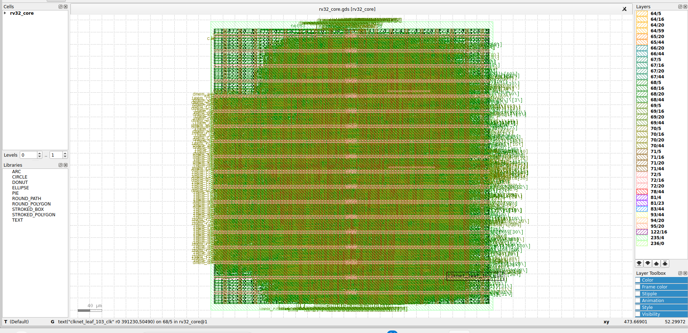

# RTL-to-GDSII Implementation of a 5-Stage RISC-V Core using OpenLane (SkyWater 130nm)

A 5-stage pipelined **RV32I** core written in Verilog, verified with a self-checking
testbench, and taken through the full RTL-to-GDSII flow with **OpenLane 2** on the open-source
**SkyWater sky130A** PDK (`sky130_fd_sc_hd`).



## Results

| Metric | 20 ns clock (50 MHz) | **25 ns clock (40 MHz)** |
|---|---|---|
| Setup worst slack (all PVT corners) | -0.535 ns (4 violating paths) | **+4.80 ns, 0 violations** |
| Hold worst slack | +0.111 ns, 0 violations | +0.112 ns, 0 violations |
| Standard-cell instances | 11,763 | 11,822 |
| Cell area | 104,764 um^2 | 104,560 um^2 |
| Core area / utilization | 206,652 um^2 / 50.7 % | 206,652 um^2 / 50.6 % |
| Total power | 12.1 mW | 9.55 mW |
| Route DRC / Magic DRC / KLayout DRC errors | 0 / 0 / 0 | 0 / 0 / 0 |
| LVS errors | 0 | 0 |
| Inferred latches | 0 | 0 |
| Antenna-violating nets (after repair) | 28 | 21 |

* **Final design point: 25 ns.** Timing closes at every PVT corner (18 corner/parasitic combinations).
* At 20 ns the only failing corner was slow silicon (ss, 100 C, 1.60 V) with worst-case parasitics; typical and fast corners had 9+ ns of positive slack. The worst-corner critical path is about 20.2 ns at the 25 ns clock, which limits sign-off fmax to roughly 49 MHz.
* **Known limitation:** 21 nets still report antenna violations after OpenLane's diode insertion/repair. DRC and LVS are clean.

## Microarchitecture

```
   +----+   +----+   +----+   +-----+   +----+
   | IF |-->| ID |-->| EX |-->| MEM |-->| WB |
   +----+   +----+   +----+   +-----+   +----+
    PC,      decode,  ALU,     LD/ST     regfile
    imem     regfile  branch   dmem      write
             read     resolve
```

* ISA: RV32I (integer ops, byte/half/word loads and stores, branches, JAL/JALR, LUI/AUIPC). No CSRs, FENCE, ECALL/EBREAK or traps.
* **Data hazards:** forwarding EX/MEM->EX and MEM/WB->EX, plus register-file write-through (WB->ID).
* **Load-use hazard:** 1-cycle stall, then forwarded from MEM/WB. Load data is deliberately not forwarded combinationally from MEM, which keeps `dmem_rdata` off the EX critical path.
* **Control hazards:** branches and jumps resolve in EX, predict-not-taken, 2-cycle penalty.
* **Memory interface:** separate instruction and data ports (combinational read, byte-strobe write). Memories sit outside the core, so no SRAM macro is needed.
* Register file: 31x32 flip-flops (x0 hardwired to zero), 2 read / 1 write ports. Async active-low reset.

### Ports
| Port | Dir | Width | Description |
|---|---|---|---|
| `clk`, `rst_n` | in | 1 | clock, async active-low reset |
| `imem_addr` / `imem_rdata` | out / in | 32 | instruction fetch |
| `dmem_addr` | out | 32 | data address |
| `dmem_wdata`, `dmem_wstrb` | out | 32, 4 | store data, byte strobes |
| `dmem_re` | out | 1 | load request |
| `dmem_rdata` | in | 32 | load data |

## Repository layout
```
rtl/        rv32_core.v (top), rv32_alu.v, rv32_regfile.v, rv32_decode.v, rv32_imm_gen.v
tb/         tb_rv32_core.v   self-checking testbench with behavioural memories
sw/         test.S (self-checking program), asm.py (small RV32I assembler), test.hex
openlane/   config.json (OpenLane 2), config_openlane1.json (OpenLane 1), src/ (copy of rtl/)
scripts/    run_openlane.sh
docs/       layout.png
Makefile    sim / synth / lint / openlane / clean
```

## Verification
```bash
sudo apt install iverilog yosys
make sim      # assembles sw/test.S, runs the testbench -> "[TB] PASS after 392 cycles"
make synth    # Yosys generic synthesis + structural checks
```
The test program covers ALU ops, immediates, forwarding chains, load-use stalls, byte/half
loads and stores, all six branch types (taken, not taken, wrong-path flush), JAL/JALR/AUIPC,
a loop, and a Fibonacci kernel. The testbench was mutation-tested: injected bugs (no EX/MEM
forwarding, no WB forwarding, no load-use stall, no flush) were all detected.

## Running the RTL-to-GDSII flow
Needs Docker and OpenLane 2 (`pip install openlane`; Python 3.12 recommended).
```bash
bash scripts/run_openlane.sh
```
The script copies `rtl/*.v` into `openlane/src/` (OpenLane's container can only read files
inside the config folder), then runs synthesis, floorplan, PDN, placement, CTS, routing,
antenna repair, multi-corner STA, GDS stream-out, DRC (Magic + KLayout) and LVS (Netgen).
Results land in `openlane/runs/<tag>/final/` (`gds/rv32_core.gds`, `metrics.json`, ...).

Key settings in `openlane/config.json`: `CLOCK_PERIOD` 25 ns, `FP_CORE_UTIL` 40 %,
`PL_TARGET_DENSITY_PCT` 50, CTS on, antenna repair on.

## Limitations and future work
* No on-chip memories (an OpenRAM SRAM macro could be integrated).
* Memory ports assume combinational read.
* No branch predictor, CSR/trap support or M extension.
* Antenna violations (21 nets) remain; could be reduced by tuning repair settings or routing constraints.
* Sweep further clock periods (22-24 ns) to find the true fmax at all corners.
